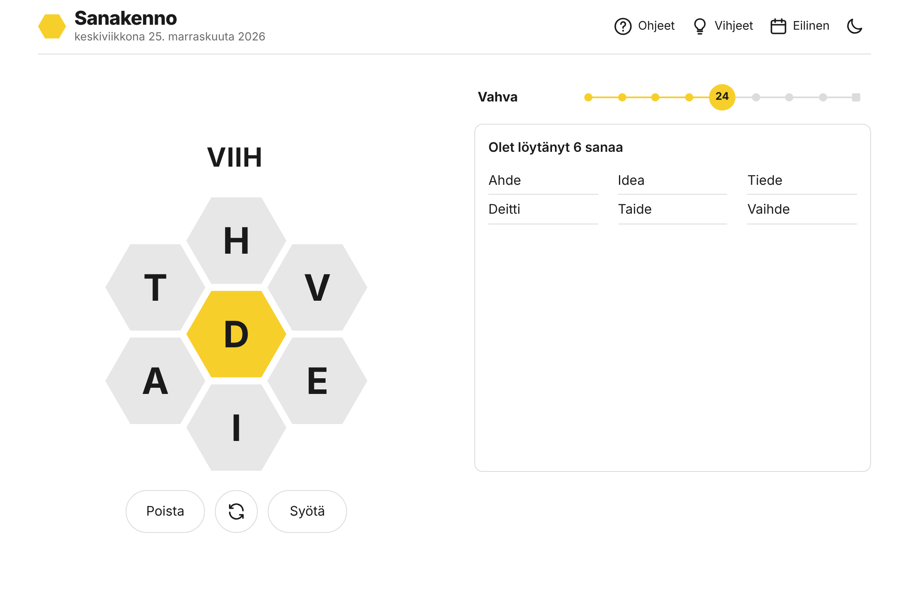
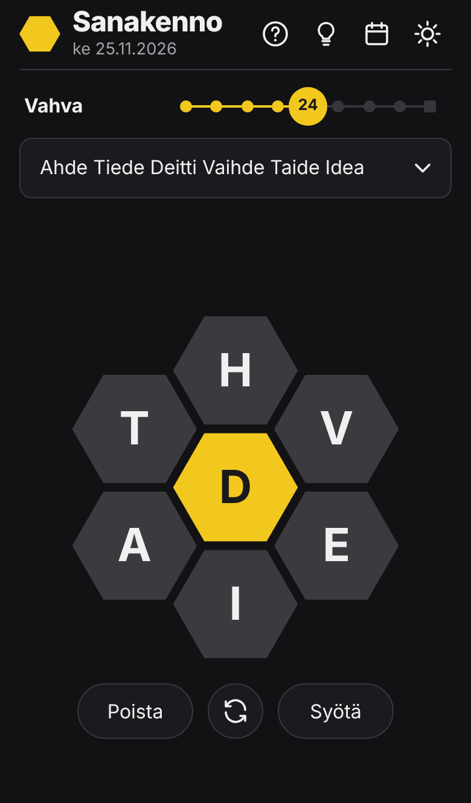

# Sanakenno

**Play it here: https://apreponen.github.io/spelling_bee/**

A daily Finnish word puzzle of the "spelling bee" kind: make as many words as you can from seven letters,
always using the yellow center letter.

*Sanakenno on päivittäinen sanapeli: muodosta sanoja kennon seitsemästä kirjaimesta. Jokaisessa sanassa
on oltava keltainen keskikirjain.*

| Desktop | Phone, dark theme |
| --- | --- |
|  |  |

## How to play

- Make words from the seven letters. Each word needs **at least 4 letters** and must contain the
  **yellow center letter**. Letters can be used more than once.
- Only **dictionary forms** count: *talo* but not *talossa* or *talot*, *juosta* but not *juoksen*.
  Compound words and adverbs (*ulkona*, *päällä*) count when they are in the word list.
- Points: a 4-letter word is worth 1 point, longer words 1 point per letter. A **pangram** uses all
  seven letters and is worth 7 extra points. Every puzzle has at least one.
- Ranks go from *Aloittelija* to *Nero* (70 % of the day's points). There is also a secret top rank,
  *Kuningatar*, for finding every word. It is not listed in the game's rank table; players discover it
  when they get there.
- **Vihjeet** (hints) shows how many words are left by first letter and length, and by their first two
  letters. **Eilinen** shows yesterday's answers.
- You can type: <kbd>Enter</kbd> submits, <kbd>Backspace</kbd> deletes, <kbd>Space</kbd> shuffles.
  On an English keyboard the <kbd>;</kbd> and <kbd>'</kbd> keys type Ö and Ä.
- A new puzzle appears every day at midnight (the player's own time). Progress is saved in the browser.

## How the word list was adapted to Finnish

The game uses the Kotus *Nykysuomen sanalista 2022* (`data/nykysuomensanalista2022.csv`, unchanged).
English Spelling Bee accepts inflected forms like *dogs* and *walked*. Finnish words have hundreds of
inflected forms each, so instead the game accepts exactly the **headwords of the Kotus list**:

- **Kept:** single words, including compounds (*sähköisku*), plural-only words (*häät*), adverbs,
  numerals and pronouns.
- **Left out** (by `scripts/build_data.py`): multi-word phrases (*ennen kuin*), prefixes and suffixes
  (*ala-*, *-inen*), hyphenated words (*keski-ikä*), abbreviations (*ALV*), words with digits or
  accented letters, and slurs and swear words listed in `data/words_removed.txt`.
- **Puzzle letters** are the letters of native Finnish words: `a d e g h i j k l m n o p r s t u v y ä ö`.
  So loan-word letters (b, c, f, q, w, x, z, å, š, ž) never appear.

That gives 101,266 usable words, of which 48,194 can appear in a puzzle (at least 4 letters, at most
7 different letters). They are in `src/data/words.txt`.

**Choosing good puzzles.** The Kotus list is big and has many rare words, so the build script uses
word frequencies from the [wordfreq](https://github.com/rspeer/wordfreq) package to pick puzzles that
are mostly made of familiar words. A new puzzle must have:

- 20–60 answers and at most 360 points,
- a well-known pangram that is a noun, adjective or verb (not a frozen adverb like *pyörälle*),
- at least 70 % of its points from familiar words, so *Nero* is reachable without obscure words.

Every valid word is still accepted, rare or not. Frequencies only decide which letter combinations
become puzzles. This gives 2,559 puzzles, about 7 years of daily games, in `src/data/puzzles.json`.

## Running the game on your computer

You need [Node.js](https://nodejs.org/) 22 or newer. In this folder, run:

```bash
npm install
```

```bash
npm run dev
```

Then open the address it prints (usually http://localhost:5173). Changes to the code show up
immediately.

## Changing the word list

You need Python 3.10 or newer. Install the Python packages once:

```bash
pip install -r requirements.txt
```

1. Add words the game should reject to `data/words_removed.txt`, or extra words to
   `data/words_added.txt` (one word per line).
2. Rebuild the game's data:

   ```bash
   python scripts/build_data.py
   ```

3. Check a puzzle and all of its answers (today, a date, or `+1` for tomorrow):

   ```bash
   python scripts/show_puzzle.py +1
   ```

4. Commit the changed files, including `src/data/`.

Rebuilding keeps the existing puzzle schedule. It only replaces a puzzle that is no longer playable
(fewer than 15 words or no pangram left), and adds more puzzles when less than a year is left.
`python scripts/build_data.py --new-schedule` makes a brand-new schedule, which changes today's
puzzle for everyone. The quality rules are constants at the top of `scripts/build_data.py`.

## Publishing the game

`npm run build` creates a `dist/` folder with the finished game. It is a plain static website, so any
static host works.

**GitHub Pages** (the workflow is already set up in `.github/workflows/deploy.yml`):

1. In the repository on GitHub, open **Settings → Pages** and set **Source** to **GitHub Actions**.
   Pages needs a public repository, unless you have a paid GitHub plan.
2. Every push to `main` then publishes the game at `https://<your-username>.github.io/spelling_bee/`.
   To publish straight away, run **Deploy to GitHub Pages** from the **Actions** tab.

Until Pages is switched on, the workflow only checks the setting and stops without an error.

**Without GitHub Pages:** run `npm run build` and drag the `dist` folder onto
[Netlify Drop](https://app.netlify.com/drop), or use another static host such as Cloudflare Pages.

## Tests

```bash
npm test
```

```bash
python -m pytest
```

GitHub runs both, plus a type check and a build, on every push (`.github/workflows/ci.yml`).

## Project layout

```
data/                     Kotus word list (original) + your additions and removals
public/                   files copied as-is into the game (icon, third-party licenses)
scripts/build_data.py     word list -> src/data/words.txt and src/data/puzzles.json
scripts/show_puzzle.py    print a day's puzzle and answers
src/game/logic.ts         game rules: scoring, ranks, hints, dates
src/game/store.ts         game state and saving progress in the browser
src/texts.ts              all Finnish texts of the game
src/components/           the hive, word list, progress bar and pop-up windows
src/App.vue               page layout and keyboard handling
```

## Credits

- Word list: [Kotimaisten kielten keskus (Kotus)](https://kotus.fi/), *Nykysuomen sanalista 2022*.
  The original file is in `data/` unchanged; the game uses a filtered version of it. Keep this
  attribution, and check the license terms on the Kotus page you downloaded the list from (Kotus
  publishes its open data under Creative Commons licenses, and older versions of this list were also
  offered under LGPL and EUPL).
- Word frequencies for choosing puzzles: [wordfreq](https://github.com/rspeer/wordfreq) by Robyn Speer.
  It is only used by the build script and is not part of the game.
- Built with [Vue](https://vuejs.org/) and [Vite](https://vite.dev/).

## License

You choose. No license has been picked for this project's own code yet, which means that by default
all rights are reserved. To pick one, add a `LICENSE` file; on GitHub, use **Add file → Create new
file**, name it `LICENSE` and click **Choose a license template**.

Third-party parts keep their own terms; see [THIRD_PARTY_NOTICES.md](THIRD_PARTY_NOTICES.md). In short:
credit Kotus for the word list, and keep `public/third-party-licenses.txt` (Vue's license) with the
published game.
